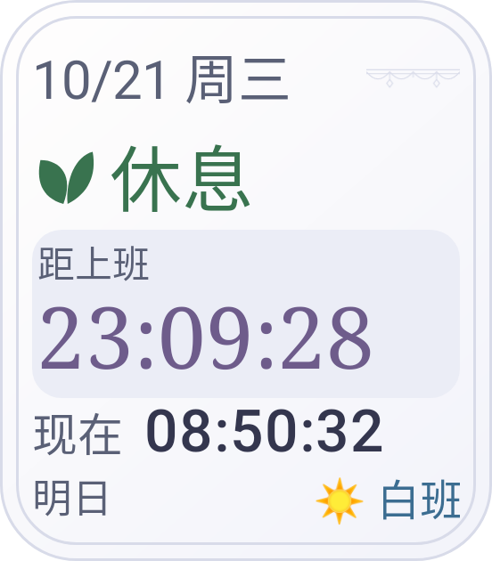
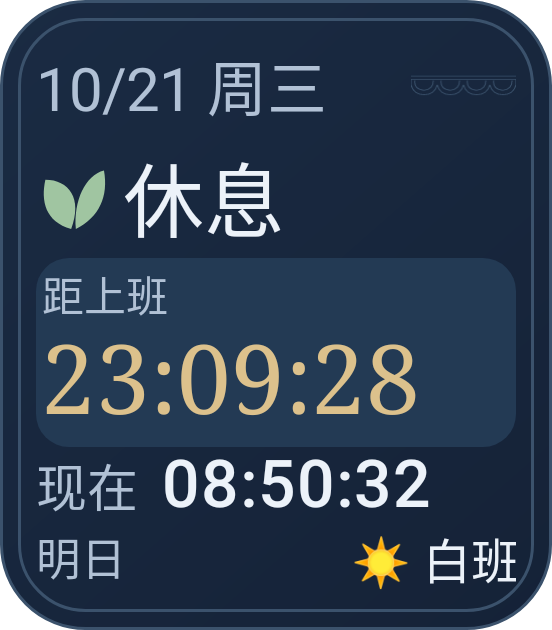
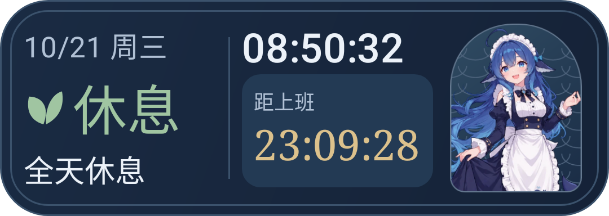
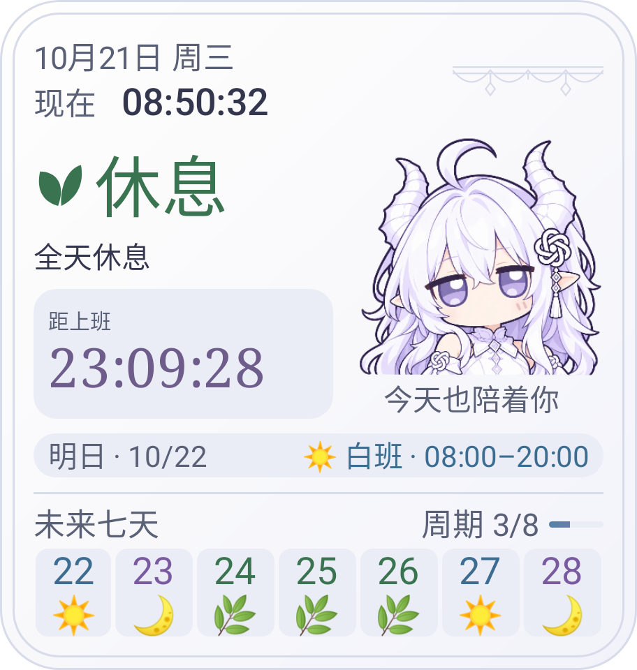
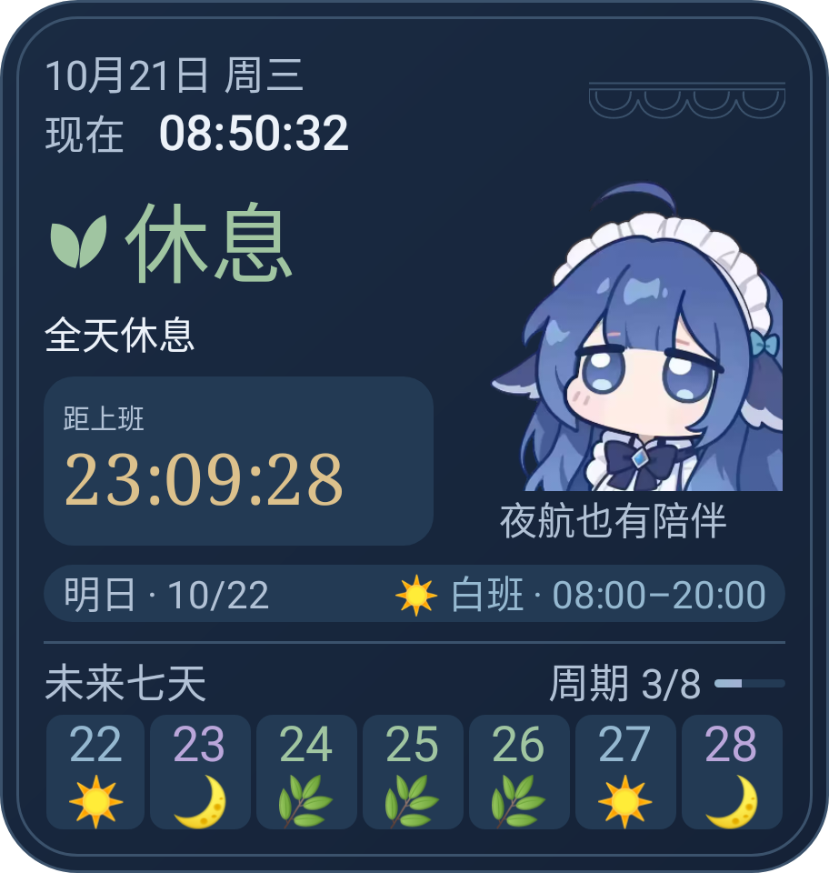

# 桌面小部件

小组件提供三个新建入口：小方卡、三段横条、完整方卡。点击整张卡打开排班页面，
不设置独立的角落刷新按钮。旧紧凑方卡实例保留，覆盖安装后使用小方卡构图。

小组件与网页共用排班配置，外观跟随**系统深浅色模式**，独立于网页的主题设置。
银昼采用珍珠白 / 灰紫，蓝夜采用深海蓝 / 暖金；装饰与人物来自源网页项目，
全部限制在卡片内部。

视觉细节见 [设计说明](DESIGN_NOTES.md#桌面小部件排版系统)。

## 渲染预览

以下六张图片由当前小组件的原生布局分别渲染，使用同一份示例排班，不是手机截图。
每行对应一种构图，左右分别展示银昼与蓝夜主题。

|                                                             银昼 · 浅色                                                             |                                                              蓝夜 · 深色                                                              |
| :-----------------------------------------------------------------------------------------------------------------------------: | :-------------------------------------------------------------------------------------------------------------------------------: |
|    **小方卡**     |    **小方卡** · 184×210dp     |
|     **三段横条**      |     **三段横条** · 360×128dp      |
| **完整方卡**   | **完整方卡** · 304×320dp   |

> 图中尺寸是示例画布，不代表固定桌面格数。实际显示会随 Launcher 可用空间、系统字体与缩放设置调整，以实机为准。

## 三种构图

| 形态   | 基准画布      | 内容                                 | 最小调整尺寸    |
| ---- | --------- | ---------------------------------- | --------- |
| 小方卡  | 128×128dp | 日期、班次、封闭倒计时面板、当前时间、明日提示            | 110×110dp |
| 三段横条 | 360×128dp | 班次 / 当前时间与倒计时 / 封闭立绘肖像窗            | 224×92dp  |
| 完整方卡 | 304×320dp | 日期与时间、班次与倒计时、透明 Q 版人物、明日安排、未来七天与周期 | 224×240dp |

横条由三个有界区域组成，空间不足时收起人物，优先保留班次与数字。
完整卡使用透明 Q 版人物，不加独立底景。小卡高度不足时收起明日提示和倒计时标签；
完整卡较矮时收起明日安排与人物注释，七天排班仍保留。
格数仅作为选择器建议，实际可用区域由手机桌面决定。

## 排班与班次风格

- 与网页共用自定义周期、起始日期和班次定义，支持任意班名、工作 / 休息属性、自定义时间及表情。
- 已定义班次以 `isWork` 判定工作属性，以 `cssClass` 决定配色；不因名字包含"休"或使用休息绿就改成休息日。
- 支持中班、清晨、晚霞等全部六种预设风格；主班次使用太阳、月亮、叶片、晴云、日出、暮城矢量图标，通用工作班使用剪贴板。
- 用户自定义表情原样保留；明日提示和七天条沿用配置里的表情，文字按各自班次风格着色。双主题下的班次文字与卡片表面对比度不低于 4.5:1。
- 跨日规则与网页一致：显式 `crossDay` 或下班时间不晚于上班时间；同一时刻上下班代表 24 小时班，显式跨日也可超过 24 小时。
- 凌晨延续尚未结束的昨日班次；明日与七天条按民用日期取班。倒计时按完整周期寻找下一工作班次，全休息周期不显示虚构倒计时。
- 缺失定义的班次使用网页相同的默认规则；定义中的时间、风格、表情和工作属性按相同契约归一化。

## 状态文案

状态行只在两种情况下出现，避免与其它行重复：

| 时机   | 状态行    | 说明              |
| ---- | ------ | --------------- |
| 上班前  | 待上班    | 提示还没到           |
| 上班中  | *（不显示）* | 倒计时行已写「距下班」，不重复 |
| 下班后  | 已下班    | 提示这个班次已经过了      |
| 休息日  | *（不显示）* | 时段行已写「全天休息」，不重复 |

「现在」标签位于当前时间前。卡片宽度不足 120dp 时该标签自动隐藏，
把宽度让给时间本身，避免被裁切。

## 边界与字体

- 布局只使用 RemoteViews 支持的原生容器；时钟、倒计时、日期与排班不栅格化。
- 内容实际应用圆角安全内缩；背景声明系统识别的 `android.R.id.background`，装饰不出血。
- Android 8+ 使用原生 TextView 自动字号，按实际测量宽高收敛，而不是完全相信桌面上报的尺寸。
  日期与说明、信息值、当前时间、班名和倒计时分别设置字号上限；空间充足时放大，紧凑时自动缩小。
  最大字号跟随系统字体设置；长班名允许省略，但完整名称、时段保留在无障碍描述里。
- Android 12+ 除上报尺寸外提供减去 20 / 40dp 的内容版本，由宿主按实际大小选择，兼容额外内边距。
  旧系统保留横竖屏版本，Android 5–7 使用保守字号兜底；极端小空间的可读性仍以实机为准。
- 横条人物窗单独生成并缓存有界小位图，不依赖桌面对轮廓裁剪的实现；完整卡仍直接使用透明人物资源。
- 主班次的六种预设图标及通用工作图标采用矢量图，用户自定义表情不替换。两套主题继续从原生深浅色资源解析。

桌面可用空间、字体替换和省电策略由系统与 Launcher 决定；布局按实际测量空间适配，
不假定各厂商行为一致。

## 实时刷新与系统限制

- 时钟由桌面中的 `TextClock` 逐秒更新；Android 7+ 的倒计时由 `Chronometer` 倒计时模式逐秒更新，即使应用进程退出也能继续走动。
- Android 5–6 没有原生倒计时模式，采用亮屏时非唤醒的逐秒闹钟兼容路径，熄屏停止；推荐 Android 7+。
- 不用后台服务持续每秒推送。上班、下班、跨日班结束、午夜以及倒计时不足 10 小时 / 1 小时的格式边界会重新绑定；倒计时通过有效的 `%s` 格式补齐为 `HH:mm:ss`，超过 99 小时保留完整小时数。
- 重新绑定会替换倒计时的 `Chronometer` 实例，其余内容保持原位。整张卡点击打开应用。
- Android 7+ 另有不依赖应用进程常驻的分钟级恢复尝试，使用非唤醒闹钟，熄屏时不重绘；保留非唤醒的半小时兜底。分钟级恢复不是系统保证的时限，休眠、省电及权限限制均可能延后。
- Android 12+ 使用"闹钟和提醒"特殊访问权限，让状态边界精确触发；从小组件打开应用时会说明并提供授权入口。
- 未授权时退回系统允许的非精确闹钟，正常的原生计时不受影响，但班次切换、格式补零切换及冻结后的恢复可能延迟；打开应用、解锁（进程仍在时）可立即校准。
- 监听重启、应用升级、系统校时、时区与日期变化；进程存活时也会在亮屏、解锁、系统主题变化和分钟广播重新校准。
- 小米等厂商的强制冻结 / 强制停止仍可能阻止广播和闹钟，需要允许应用自启动及正常后台运行；应用无法绕过系统限制。